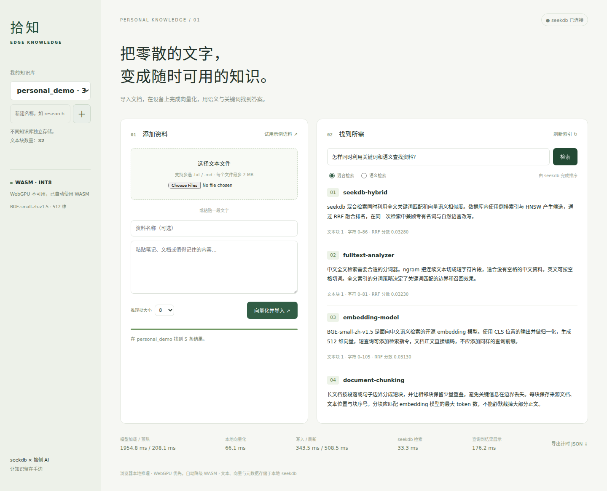

# 拾知：浏览器端 AI 推理与 seekdb 混合检索

本项目完成文本导入 → 浏览器本地向量化 → seekdb 持久化 → 数据库混合检索。支持中文、增量导入、重复提交幂等、知识库切换、进度显示和计时导出。



依据 [官方题目](https://oceanbase.yuque.com/org-wiki-obtech-vh7w9r/hc3pio/kw9wfx4bu9pyvat9)，从 `oceanbase/powercontext` 的 `2026-competition-ecosystem` 分支、基线 commit `d647275c308e09b7b623f322a26f5c4e85734fb0` 开发，所有资产均位于 `stepfun/`。提交仓库为用户指定的 `Luchutong/seekdb-TJU`。

## 启动

需要 Node.js 22+（建议 24）、npm、近期 Chrome / Edge；Docker 方式建议至少 4 GB 可用内存和 8 GB 可用磁盘。模型推理使用用户设备的浏览器，Node 服务只负责文件服务、参数校验和 seekdb 操作。

```bash
cd stepfun
cp .env.example .env
ONNXRUNTIME_NODE_INSTALL_CUDA=skip npm ci
npm run models
npm run db:up
npm run build
npm start
```

打开 **http://127.0.0.1:4177**。也可在本目录直接运行 `bash scripts/start.sh` 完成安装、模型获取、数据库启动、构建和启动。开发模式为 `npm run dev`。

`ONNXRUNTIME_NODE_INSTALL_CUDA=skip` 仅跳过 Transformers.js 依赖包附带的服务端 CUDA 库下载，实际推理始终使用浏览器内的 ONNX Runtime Web。`.npmrc` 的 `legacy-peer-deps` 避免 SDK 自动拉取其默认服务端 embedding 插件；集合创建和读取均显式设置 `embeddingFunction: null`。

模型获取脚本从公开 Hugging Face 仓库下载固定 revision 的配置、分词器和 FP32/FP16/INT8 ONNX 文件，采用临时文件和原子重命名，并记录文件字节数、SHA-256 与来源。约需下载 167 MB，输出到 `public/models/bge-small-zh-v1.5/`。后续访问只请求本机模型文件，允许断网运行。网络需要代理时，Node 24 可使用 `NODE_USE_ENV_PROXY=1 npm run models`，配合已有的 `HTTPS_PROXY`。模型权重、数据库数据和 `node_modules` 不纳入 Git。

### 已有数据库 / 无 Docker

已有 seekdb 1.4 可配置 `.env` 的 `SEEKDB_HOST/PORT/USER/PASSWORD/DATABASE`，省略 `npm run db:up`，或运行 `bash scripts/start.sh --existing-db`。数据库启动后应用会创建独立数据库，默认名称 `stepfun_edge`。

Linux 无 Docker 时，可使用官方 `pylibseekdb==1.4.0.post1` 包中的独立 server：

```bash
# 需要 Python 3.12+、venv 与 pip。仅安装及启动数据库，不进行 Python 推理。
bash scripts/db-native.sh
npm run build
npm start
```

脚本在 `.data/` 内安装并保存数据库，默认端口 2883、CPU 2、内存预算 2 GB。可通过 `SEEKDB_BIN` 指定已安装的官方 server 二进制，通过环境变量 `SEEKDB_PORT` 指定端口。停止原生实例可向 `.data/native/run/seekdb.pid` 所记录的进程发送 `SIGTERM`；保留 `.data/` 即保留数据库。Docker 数据位于具名卷；`npm run db:down` 停止服务并保留数据。

本次实际验证使用官方 1.4.0 server 二进制和上述原生启动脚本；Docker Compose 已通过配置校验，但当前网络从 Docker Hub 拉取镜像返回 EOF，未声称容器启动验证通过。

## 使用

1. 点击“试用示例语料”，或多选 UTF-8 `.txt/.md` 文件、粘贴文本后点击“向量化并导入”。默认按 180 个 Unicode 字符分块，重叠 30 字符。每文件最多 2 MB，每次最多 100 个文件 / 10000 个文本块。
2. 界面显示模型加载、向量化进度和当前后端；导入完成提示“索引已刷新”。在搜索框输入中文问题，默认进行数据库内全文 + 向量 RRF 混合检索，也可切换纯语义检索作比较。
3. 结果包含排序、原文片段、来源名称、块序号和原文字符位置。位置按换行归一化为 LF 后的 Unicode 码点计数。名称和正文均按文本展示。
4. 左侧可创建与切换知识库，名称为小写字母开头的 1–40 位字母、数字、下划线。切换后清除旧结果，刷新页面恢复所选知识库。
5. 相同“来源名称 + 原文内容”使用同一摘要 ID，重复导入不会增加记录。内容改变视为一个新文档版本，保留旧版本；当前版本不提供替换、删除和多人权限管理。
6. 每次导入最多 128 块一批写入，默认在完整导入结束后统一刷新索引。失败时保留报错；已提交批次可通过相同导入重试，稳定 ID 避免重复。也可点击“刷新索引”重试刷新。

## 模型、后端和数据层

- [BAAI/bge-small-zh-v1.5](https://huggingface.co/BAAI/bge-small-zh-v1.5)，MIT；使用 [Xenova ONNX 转换版本](https://huggingface.co/Xenova/bge-small-zh-v1.5/tree/75c43b069aac4d136ba6bc1122f995fedcfd2781)，固定 revision `75c43b069aac4d136ba6bc1122f995fedcfd2781`。CLS 池化、L2 归一化、512 维、最多 256 tokens，查询添加模型推荐的中文检索指令。原文不添加指令。
- Transformers.js 3.8.1，ONNX Runtime Web 版本由锁文件固定。Worker 探测 GPU 适配器及 `shader-f16`，优先 `device: 'webgpu', dtype: 'fp16'`；不可用、缺少半精度特性、加载/预热/推理失败时自动转为 `device: 'wasm', dtype: 'q8'`。初始化后用真实模型预热，再宣布就绪。推理阶段 GPU 失败会从头重跑整批，不混合前后两种后端的部分输出。
- 固定版本的 INT8 模型采用上游已发布的 ONNX 动态量化产物 `model_quantized.onnx`，上游 `quantize_config.json` 指定 `QInt8`、逐通道、`reduce_range`；FP16 产物为 `model_fp16.onnx`。**使用发布方提供的量化模型，无需训练或本地重新量化**。下载脚本一并保存量化配置及文件哈希，复现时选择相同文件即可。
- 本环境的 SwiftShader 缺少 `shader-f16`。实测旧 ORT 的 INT8 WebGPU 路径产生语义向量偏差，因此默认策略不启用该组合。FP32 WebGPU 仅通过评测接口用于正确性对照，不是默认量化运行配置。
- seekdb-js 1.4.0 创建每个知识库独立的集合；底层包含 `_id`、`document`、`embedding VECTOR(512)`、JSON `metadata`，配置 cosine HNSW 和 `ngram` 全文索引。元数据保存来源、完整文档摘要 ID、块号、起止位置和固定模型签名。`edge_v1_` 命名空间绑定模型/分块版本，模型变更应迁移到新命名空间重新编码。
- `collection.hybridSearch()` 将全文条件、查询向量、候选数和 RRF 参数交给 `DBMS_HYBRID_SEARCH.GET_SQL`，执行数据库生成的融合 SQL；浏览器和 Node 均不拼接两路检索结果。默认每路候选 20、最终 5、RRF 常数 60。纯向量对照调用 `collection.query()`。
- SDK 使用连接会话变量，因此整个 `SET → GET_SQL → SELECT` 序列以及集合写入/刷新均经服务端队列串行执行，防止多标签页或并发查询互相覆盖会话状态。所有向量必须由浏览器提供并通过签名、维度、有限数值与归一化校验。
- 向量化在 Worker 中批处理，按长度排序减少 padding，再恢复原顺序；复用模型、浏览器文件缓存和 256 项 LRU 向量缓存。精度变化时清空向量缓存，文档和查询角色通过实际前缀区分。

## 测试与实验

```bash
npm test
npm run build
# 先启动数据库和应用；安装本地测试浏览器。
npx playwright install chromium
npm run test:e2e
npm run bench
```

默认基准重复 3 次，每个配置使用相同的 32 篇中文文档和 20 条标注查询，分别测混合检索和向量检索。基线为 FP32/WASM/批 1；INT8/WASM/批 1 隔离量化效果；INT8/WASM/批 8 隔离批处理效果。另记录自动后端以及 FP32 WebGPU 对照。每次使用新的 seekdb 集合，强制关闭向量结果缓存，不复用预计算向量。刷新实验在相同精度和写入批大小下，比较逐次刷新与末尾一次刷新。

`npm run bench` 输出 `reports/benchmark.json`，包含每条查询的返回来源、相关标注、Recall@5、nDCG@5、阶段计时和汇总中位数。首次模型加载与后续缓存加载分开记录；Worker Resource Timing 给出实际 ONNX 传输字节和资源下载耗时，加载时间包含本地资源读取/下载与会话建立。查询总时间包括查询向量化、HTTP、seekdb 检索、DOM 更新及两次 animation frame。此处不声称测量显示器的实际呈现时刻。

可设置 `BENCH_REPEATS=3`、`BENCH_OUTPUT=reports/new-benchmark.json`、`APP_URL=http://127.0.0.1:4177`、`CHROMIUM_PATH=/path/to/chrome`。没有硬件 GPU 的 Linux/CI 可用 `SOFTWARE_GPU=1 npm run test:e2e` / `SOFTWARE_GPU=1 npm run bench` 验证软件 WebGPU；软件适配器的速度不能外推到硬件 GPU。

测试包含：分块 Unicode/覆盖范围，模型与向量校验，会话串行化，真实浏览器文件导入、增量/重复写入、刷新后召回、空集合、集合隔离、并发混合检索、刷新页面恢复、移动端布局，以及阻止所有非本机 HTTP 请求。端到端测试另外验证不支持 WebGPU 和 FP16 初始化失败时的 WASM 降级。

实验原始记录、技术说明及截图见 [reports/](reports/) 和 [TECHNICAL.md](TECHNICAL.md)。这些结果来自提交应用的真实运行，小型人工评测集只用于回归比较，不代表通用精度或竞赛得分。
